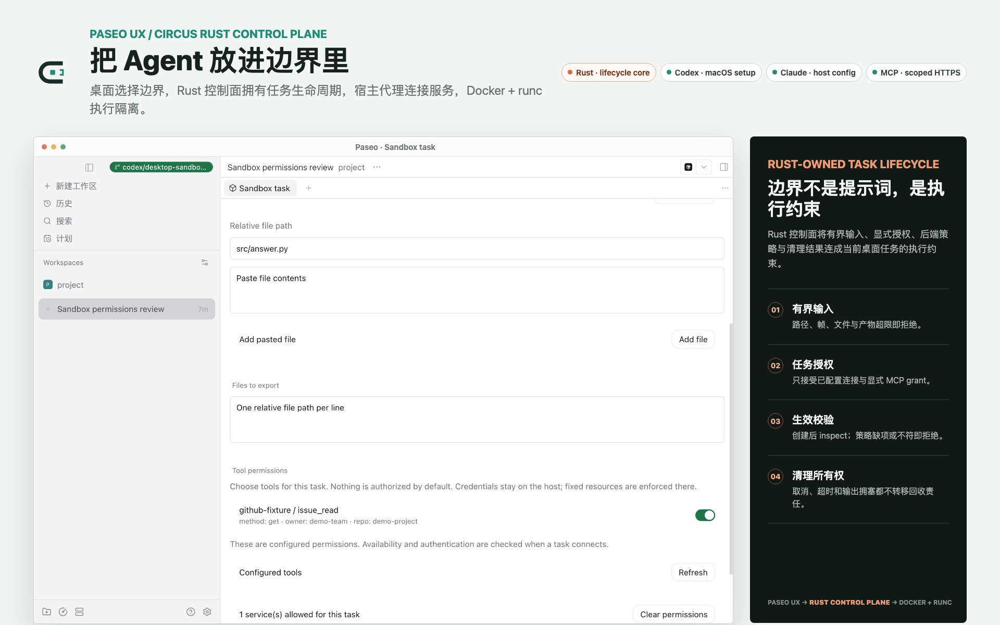
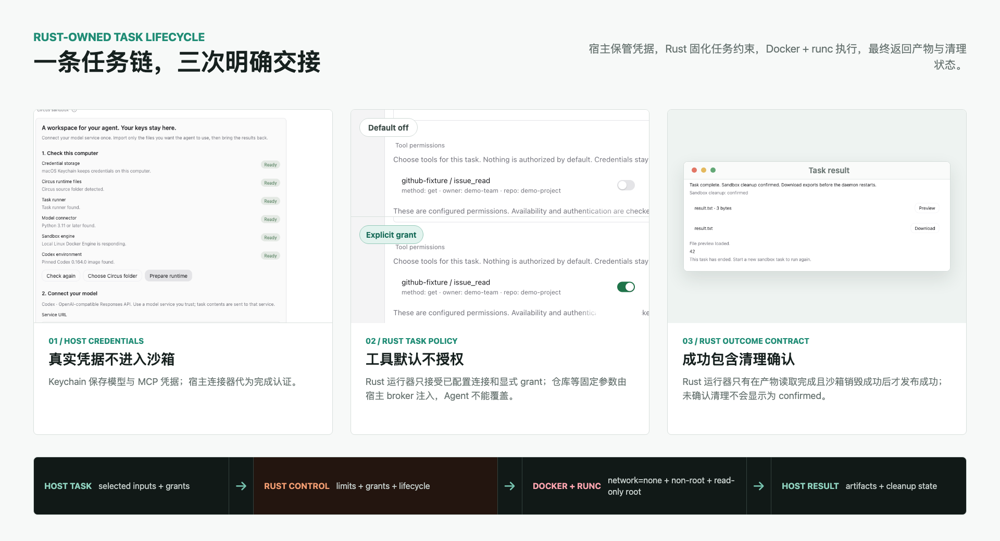
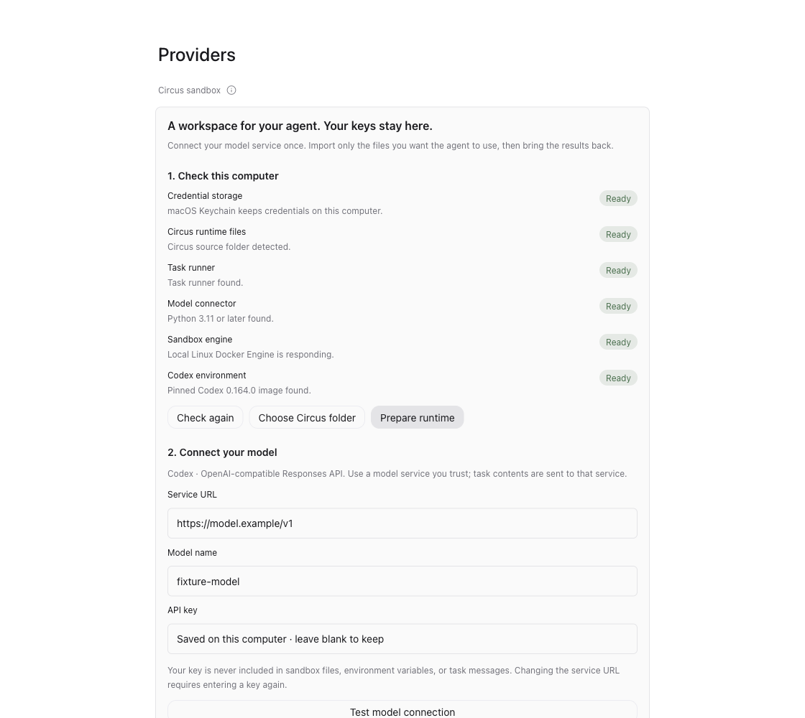
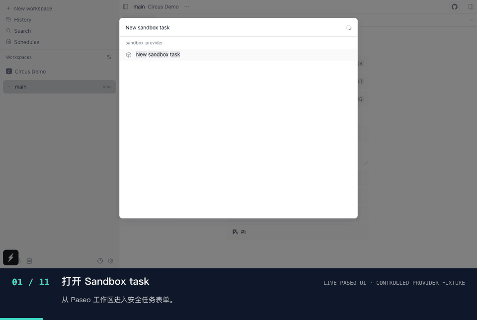
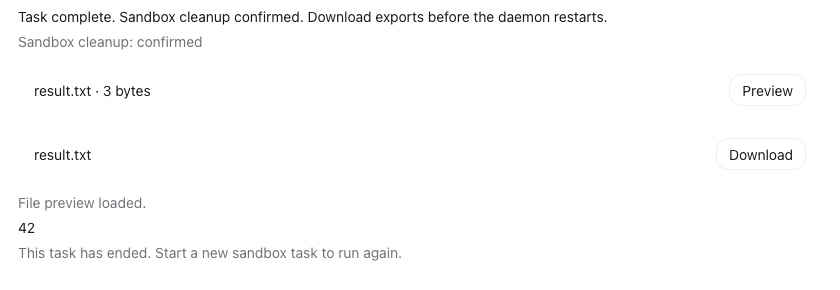
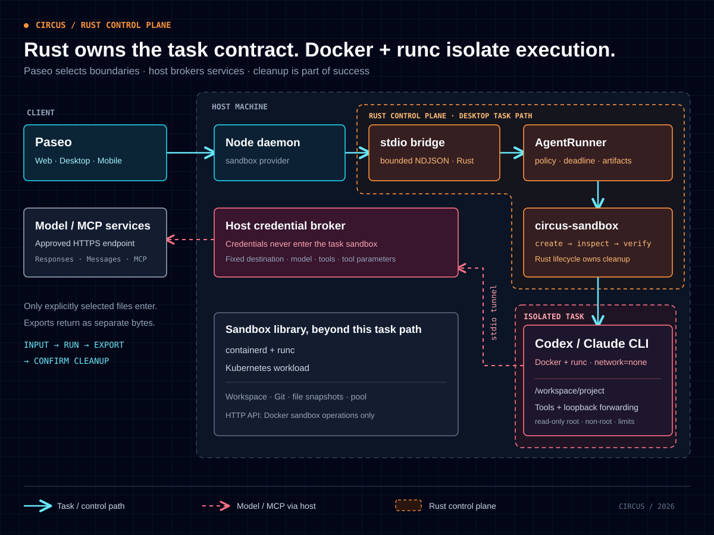

<h1 align="center">
  <picture>
    <source media="(prefers-color-scheme: dark)" srcset="docs/assets/circus-logo-dark.svg">
    
  </picture>
  <br>
  Circus
</h1>

<p align="center">
  <strong>桌面级 AI Agent 安全沙箱</strong><br>
  Rust 控制面校验边界 · 真实密钥不进沙箱 · 权限按任务授予
</p>

<p align="center">
  <a href="#从桌面开始"></a>
  <a href="circus-sandbox/Cargo.toml"></a>
  <a href="https://github.com/BizerNotNull/circus/actions/workflows/sandbox-rust.yml?query=branch%3Amain"></a>
  <a href="https://github.com/BizerNotNull/circus/actions/workflows/sandbox-security.yml?query=branch%3Amain"></a>
  <a href="circus-sandbox/LICENSE"></a>
  <a href="https://github.com/BizerNotNull/circus/stargazers"></a>
</p>

<p align="center">
  <a href="#从桌面开始">桌面上手</a> ·
  <a href="#一次任务从显式授权到清理确认">交互流程</a> ·
  <a href="#rust-安全控制面">Rust 核心</a> ·
  <a href="#真实任务验收修复代码并取回产物">真实验收</a> ·
  <a href="#架构">架构</a> ·
  <a href="#快速上手">命令行</a> ·
  <a href="circus-sandbox/docs/secure-desktop-verification.md">验证</a>
</p>

<p align="center">
  
</p>

<p align="center"><sub>开发态 Paseo 工作台：输入文件、导出路径与工具权限均由当前任务显式选择。</sub></p>

**Paseo 负责交互，Rust 控制面负责把桌面任务边界落实到执行路径。** 当前 Agent 链路由三个 first-party Rust crate 校验有界任务协议、显式授权与后端策略，并统一拥有创建、取消、产物读取与清理确认；Docker + runc 执行当前进程、网络与资源隔离。
模型与 MCP 的真实凭据由宿主代理持有；Agent 通过受控通道访问获准服务，无需在沙箱中填写密钥或密码。

## 安全与易用性

从导入文件到取回结果，文件范围、工具权限、资源预算与回收状态贯穿每次任务：

- **真实凭据不进沙箱**：macOS 向导将密钥存入 Keychain，模型与 MCP 代理代为认证。真实凭据不写入沙箱配置、环境或文件。
- **文件与工具按任务授权**：只复制选定文件，容器禁网；每次任务勾选工具，宿主限制服务地址与仓库等资源参数。
- **通过 macOS 桌面配置 Codex**：检测运行环境、测试模型连接、保存凭据并选择资源预算。工具权限默认关闭。
- **结果与回收状态可查看**：查看进度、下载产物、停止任务。成功包含确认回收，清理未完成时保留状态供核查与重试。



_界面使用受控 provider fixture 展示授权与 cleanup state；真实 Docker + runc、Agent、模型与回收证据见[验收记录](circus-sandbox/docs/secure-desktop-verification.md)。_

### Rust 安全控制面

当前桌面 Agent 任务链路依次经过三个 first-party Rust crate，每一层都失败即拒绝：

| Rust 安全关口                                                                       | 失败即拒绝的约束                                                          |
| ----------------------------------------------------------------------------------- | ------------------------------------------------------------------------- |
| **01 · 协议入口** · [`circus-stdio-bridge`](circus-sandbox/stdio-bridge/Cargo.toml) | 版本化且有界的 NDJSON；拒绝超大帧、重复输入、非法路径与无效期限           |
| **02 · 任务契约** · [`circus-agent-runner`](circus-sandbox/agent-runner/Cargo.toml) | 在分配前校验文件、产物预算、期限与 MCP grant；编排单任务 Agent 和最终结果 |
| **03 · 生命周期** · [`circus-sandbox`](circus-sandbox/Cargo.toml)                   | 创建后逐项核验实际生效的后端策略；统一拥有状态、失败回收与销毁责任        |

实现可直接审计：[协议边界](circus-sandbox/stdio-bridge/src/protocol.rs)、[任务结果与清理](circus-sandbox/agent-runner/src/runner.rs)、[Docker 生效策略核验](circus-sandbox/src/infrastructure/engine_policy.rs)，以及[真实 Docker hardening 测试](circus-sandbox/tests/docker_hardening.rs)。

**先请求，再验真。** `circus-sandbox` 不把发给 Docker 的配置当作隔离已经生效的证据：容器创建后会再次 inspect，核对 runtime、内存 / CPU / PID 限制、只读根、`network=none`、capability、mount / device、tmpfs 与 namespace 等实际策略；缺项或不一致即失败，并保留资源回收责任。

因此，超限输入、未授权工具、固定参数覆盖和未确认清理都不能被包装成成功；即使取消、超时或事件背压，任务 worker 仍保留回收责任。

另一个 workspace Rust crate [`circus-sandbox-exec`](circus-sandbox/sandbox-exec/README.md) 是独立接入入口，不是上述链路的第四道串行关口。它把既有 provider 命令的原始 stdio 代理进 owned sandbox，在新建实例前恢复旧孤儿，使用有界归档保存工作区，并在退出时确认清理；它不提供模型 / MCP 代理、凭据注入、任务协议或 UI，使用方不得通过 `agent.env` 放入宿主凭据。

上述四个 first-party crate 均使用 Rust 1.99.1 / edition 2024，并设置 `unsafe_code = "forbid"`。这是 first-party 源码约束，不覆盖依赖、Python 宿主连接器、Agent CLI、Docker + runc 或 Linux 内核，也不是端到端安全证明。当前桌面 Agent 安全边界由 Rust 生命周期控制、宿主连接器与 Linux Docker + runc 共同组成；runc 容器共享宿主内核。

当前为源码开发版，macOS 桌面向导支持 Codex；Claude Code 可通过宿主配置使用。
完整信任边界见[安全设计](docs/hackathon-security.md)。

## 从桌面开始

桌面工作流由 Paseo 提供：选择文件或粘贴内容 → 填写任务、导出路径和期限 → 查看进度 → 预览、下载结果。任务使用文件副本，结果由你决定如何应用到原项目。

先按 [Paseo 开发指南](circus-paseo/docs/development.md)启动本机服务与桌面客户端，再通过界面完成 Codex 配置：

1. 打开本机的 **Settings → Providers → Circus sandbox**，检查运行环境并点击 **Prepare runtime**。首次准备仍需已安装 Docker、Python 与 Rust 工具链。
2. 填写模型服务地址、模型名和 API key，测试连接、选择资源预算，点击 **Save and enable sandbox**。密钥保存在本机 Keychain，配置通过重新加载生效。
3. 需要 GitHub 工具时，填写 MCP 连接、凭据及允许访问的仓库。创建任务时再显式勾选工具权限；默认不授权。

<details>
<summary>查看完整桌面环境检测与模型连接界面</summary>



_开发态界面，字段使用演示配置；截图已裁去本机标识。_

</details>

<details>
<summary>其他平台或 Claude Code：手动配置宿主</summary>

在 `circus-sandbox/` 执行 `cargo build --locked -p circus-stdio-bridge`，按 [stdio 宿主配置](circus-sandbox/docs/stdio-bridge.md#宿主配置)创建 `runner.json`，指定 Agent、镜像 ID、Python、资源限制和宿主凭据引用。
将以下内容合入 daemon 配置，替换三个绝对路径：

```json
{
  "agents": {
    "providers": {
      "sandbox": {
        "enabled": true,
        "command": ["/absolute/path/to/circus-stdio-bridge"],
        "env": {
          "CIRCUS_RUNNER_CONFIG": "/absolute/path/to/runner.json",
          "CIRCUS_SANDBOX_STATE_DIR": "/absolute/path/to/state"
        }
      }
    }
  }
}
```

</details>

选择 **Sandbox** 可提交纯提示词任务；需要文件时打开工作区的 **Sandbox task** 面板。完整说明见 [Paseo sandbox provider](circus-paseo/public-docs/supported-providers.md#sandbox-codex)。

沙箱会话按顺序执行：每次提示重建沙箱，从宿主状态目录中的明文工作区归档恢复已完成轮次，并让 Codex 续接原生线程；运行中的进程和进行中的 turn 不保留。产物保存在 daemon 的有界内存缓存中，**重启前需下载**；二进制下载支持 Web / 桌面端，原生移动端可预览和复制 UTF-8 文本。

## 一次任务：从显式授权到清理确认

打开 **Sandbox task**，写下任务，只加入 Agent 需要的文件和要取回的产物。工具默认关闭，需要时只为本次任务授权。提交后，Paseo 依次显示准备、运行、导出和清理状态；完成后可以预览或下载产物，并核对 `Sandbox cleanup: confirmed`。

<p align="center">
  <picture>
    <source media="(prefers-reduced-motion: reduce)" srcset="docs/assets/circus-task-walkthrough-poster.png">
    <source type="image/webp" srcset="docs/assets/circus-task-walkthrough.webp">
    
  </picture>
</p>

_回放使用真实 Paseo UI；任务事件与结果由受控 provider fixture 生成，用于稳定展示交互和状态。它不构成真实模型或容器执行证据。真实 Docker + runc、Codex、模型调用与独立回收证据见[验收记录](circus-sandbox/docs/secure-desktop-verification.md)。_

## Agent 与 MCP 支持范围

| 接入项                | 当前可用                                                             | 已验证                                                   | 仍待完成                      |
| --------------------- | -------------------------------------------------------------------- | -------------------------------------------------------- | ----------------------------- |
| Codex `0.164.0`       | 桌面配置、顺序多轮（每轮重建沙箱）、宿主模型与 MCP 代理              | 真实 `gpt-5.6-sol` + Docker + 受控 HTTPS MCP             | 发布安装包验收                |
| Claude Code `2.1.310` | 固定镜像、Messages 通道、同一任务与 MCP 契约                         | 真实 CLI + Docker + 脚本模型服务，含工具调用、取消和清理 | 真实模型推理与桌面 Agent 选择 |
| HTTPS MCP             | Streamable HTTP 工具发现与调用，JSON / 有界 SSE，凭据文件或 Keychain | 认证注入、工具授权、固定资源参数、拒绝与脱敏             | 真实 GitHub 等目标服务验收    |
| `dsh`                 | 尚未接入                                                             | —                                                        | 确认具体应用与适配协议        |

目前支持范围以表中列出的接入方式为准；OAuth 登录、本地 stdio MCP 及其余 MCP 方法尚未支持。

## 真实任务验收：修复代码并取回产物

给 Codex 一份故意写错的 `answer.py`：

```python
def add(a, b): return a - b
```

提交任务：

> 修复 `add(a, b)`，运行 Python 断言，验证 `add(20, 22) == 42` 和 `add(-2, 2) == 0`。通过后，把 `42` 和换行写入 `result.txt`。导出两个文件。

```text
导入输入 → 创建沙箱 → Codex 修改代码并执行测试 → 导出产物 → 销毁并确认
```

这条路径已使用真实 Docker、Codex 和模型网关 `gpt-5.6-sol` 完成验收：修复后的函数返回 `a + b`，`result.txt` 为 `42\n`，任务容器经独立检查确认已删除。示例的成功输出如下；模型生成的代码格式与字节数可能不同。

```text
task completed; 2 artifacts retrieved
answer.py: 28 bytes
result.txt: 3 bytes
42
```

验证安全边界时，还会检查未授权工具调用、篡改固定仓库参数和直接访问外网等请求是否被拒绝。
MCP 验收让容器内进程直接发起越权请求，并检查服务端没有收到这些调用；不只依赖 Agent 的文字回答。
真实模型读取受控 MCP Issue、导出产物，以及这组越权测试的证据见[验收记录](circus-sandbox/docs/secure-desktop-verification.md)。



_结果卡片来自受控 provider 的 UI 验收；真实模型与真实容器的证据分别记录。复现步骤见[安全演示指南](docs/hackathon-security.md#三分钟演示脚本)。_

## 架构



[打开架构图源文件](docs/assets/architecture.svg) · [下载 HTML 展示版](docs/assets/architecture.html)（本地打开；PNG / PDF 导出工具需联网加载）

下图聚焦当前 Paseo sandbox provider 的单任务链路；独立的 `circus-sandbox-exec` 进程代理复用 `circus-sandbox`，不经过 `circus-stdio-bridge` 或 `circus-agent-runner`。

### 四层职责

| 层              | 组件                                                           | 职责                                                           |
| --------------- | -------------------------------------------------------------- | -------------------------------------------------------------- |
| 交互层          | Paseo 客户端、Node daemon、sandbox provider                    | 选择输入、提交任务、展示事件、停止任务、预览和下载产物         |
| Rust 安全控制面 | `circus-stdio-bridge`、`circus-agent-runner`、`circus-sandbox` | 有界协议、任务校验、显式授权、后端策略、生命周期和最终结果契约 |
| 宿主连接层      | Python 模型连接器与 MCP broker                                 | 持有凭据，固定服务地址与资源参数，代理获准 HTTPS 请求          |
| 运行时隔离层    | Linux Docker Engine + runc                                     | 执行非 root、只读根、禁网及资源限制                            |

Rust 调用方可以直接使用运行器或沙箱库。运行器编排 Codex / Claude 驱动与宿主代理，沙箱核心通过 `api → lifecycle → infrastructure` 管理后端；**状态转换与销毁始终由 lifecycle 拥有**。

当前 Agent 链路使用 **Docker + runc**。沙箱库另有 containerd 与 Kubernetes workload 适配；独立 HTTP API 当前提供 Docker 沙箱操作，尚未提供 Agent 任务接口。

### 禁网的 Agent 如何访问模型

容器内的 Codex 访问本地回环转发器；模型请求经已有进程标准流传给宿主控制器，由宿主校验后访问指定的 HTTPS `/responses` 服务，再流式送回结果。Docker socket 只供宿主管理端使用。

通道限定模型、请求路径、请求和响应大小，不接受容器指定任意上游，也不转发它提供的真实认证头。因此可以允许 Agent 调用模型，同时保持容器 `network=none`。任务所需的软件依赖应预先放入镜像，运行时不能任意联网安装。

Claude Code 使用独立的 Anthropic Messages 通道和固定版本镜像，复用相同的任务与清理契约；
配置与验证见 [Claude 适配器](circus-sandbox/docs/claude-agent.md)。MCP 同样经回环与标准流通道到达
宿主 broker，只有宿主配置的 HTTPS 目的地、任务获准工具及参数能被使用。

### 停止任务后，清理归谁

调用方消费事件流，并另外等待最终结果。取消只是发出请求，终止与清理是否完成由最终结果确认：

| 清理状态    | 含义                             | 调用方动作                   |
| ----------- | -------------------------------- | ---------------------------- |
| `confirmed` | 已确认沙箱回收                   | 读取任务结果；成功时取回产物 |
| `pending`   | 清理尚未完成，运行器保留所有权   | 保留任务句柄并重试清理       |
| `unknown`   | 桥接中断等故障使清理状态不可确认 | 在宿主核查任务所属资源       |

## 快速上手

开发者可以通过以下终端示例验证 Agent 任务。桌面操作见[从桌面开始](#从桌面开始)。

**准备环境：** Rust 1.99.1 / Cargo（仓库已固定工具链）、宿主 Python 3.11+、Docker CLI，以及可通过本地 socket 访问的 Linux Docker Engine + runc。需要支持 **Responses SSE 和 Codex 工具调用**的 HTTPS 模型服务；仅兼容 Chat Completions 的网关不适用。以下命令使用 **Bash**，镜像演示目标为 `linux/amd64`。

<details>
<summary>获取源码</summary>

在新目录中克隆仓库：

```bash
git clone https://github.com/BizerNotNull/circus.git
cd circus
```

已有最新主干代码可以直接从下一步开始。

</details>

### 1. 构建 Agent 镜像

在仓库根目录执行。将 endpoint 改成实际使用的本地 Linux Engine socket；构建需要联网下载依赖。

```bash
export CIRCUS_DOCKER_ENDPOINT=unix:///var/run/docker.sock

docker --host "$CIRCUS_DOCKER_ENDPOINT" build \
  --platform linux/amd64 \
  --tag circus-agent-codex:0.164.0 \
  circus-sandbox/images/codex

export CIRCUS_AGENT_IMAGE="$(docker --host "$CIRCUS_DOCKER_ENDPOINT" \
  image inspect --format '{{.Id}}' docker.io/library/circus-agent-codex:0.164.0)"
```

镜像包含固定版本的 Codex CLI 0.164.0、Node.js，以及 Python、Git、ripgrep。运行时使用上一步获取的不可变 `sha256:` 镜像 ID。版本与构建边界见[镜像说明](circus-sandbox/images/codex/README.md)。

### 2. 配置模型并运行

替换地址和模型名，密钥在终端中隐藏输入。示例只读取显式配置，不复用个人 Codex 登录。

```bash
export CIRCUS_MODEL_BASE_URL=https://your-approved-gateway.example/v1
export CIRCUS_MODEL=your-approved-model
read -r -s -p 'Model API key: ' CIRCUS_MODEL_API_KEY
export CIRCUS_MODEL_API_KEY
printf '\n'

export CIRCUS_AGENT_PROMPT='Fix the existing answer.py add(a, b). Run Python assertions for add(20, 22) == 42 and add(-2, 2) == 0. Write 42 followed by a newline to result.txt after the tests pass.'

cd circus-sandbox
cargo run --locked -p circus-agent-runner --example codex_agent
unset CIRCUS_MODEL_API_KEY
```

示例自动导入错误的 `answer.py`，任务期限为 180 秒，导出 `answer.py` 和 `result.txt`。你会看到阶段、工具状态与最终产物摘要；文件字节返回到调用方内存，不会自动保存到宿主当前目录。

宿主 Python 不在默认路径时设置 `CIRCUS_HOST_PYTHON`；网关使用额外 CA 时设置 `CIRCUS_MODEL_CA_FILE`。故障分类、预算和自定义输入见 [Agent 运行器文档](circus-sandbox/docs/codex-agent.md)。

## 目前能做什么

| 能力                | 当前实现                                                                                                                  | 边界                                                                                                      |
| ------------------- | ------------------------------------------------------------------------------------------------------------------------- | --------------------------------------------------------------------------------------------------------- |
| Agent 任务          | Codex / Claude Code 单任务、显式输入、事件、取消、期限、产物、清理重试；Paseo 的 Codex 会话可用明文归档与线程 ID 顺序多轮 | Agent 运行器使用 Docker；每轮重建沙箱，只延续已完成 turn，不恢复进行中的 turn；无自动重试或持久化任务队列 |
| 凭证与工具授权      | macOS Keychain、宿主模型代理、按任务授权的 HTTPS MCP broker                                                               | 不支持 OAuth、任意宿主 stdio MCP 或全部 MCP 方法                                                          |
| 桌面配置            | macOS 环境检测、模型密钥保存、资源预算与 MCP 只读预设                                                                     | 仍需 Docker 与源码构建条件；尚非打包即用的跨平台发行版                                                    |
| Docker + runc       | 生命周期、exec、交互进程、文件、工作区快照、池租约                                                                        | 每沙箱一个交互进程；显式本地 Engine                                                                       |
| containerd + runc   | 生命周期、exec、交互进程、文件、工作区快照、池租约                                                                        | 独立沙箱库能力，尚未接入 Agent 运行器                                                                     |
| Kubernetes workload | Pod 创建与就绪、exec、交互进程、文件、工作区快照、池租约、删除                                                            | 可选 feature；无真正 pause/resume、NetworkPolicy 与 PID 限制能力；交互进程经 `pods/exec` 附加             |
| 环境与代码准备      | 本地 OCI 镜像解析、固定提交 Git clone/worktree、受预算约束的文件复制                                                      | Docker/containerd 默认使用本地镜像；Kubernetes 可由 kubelet 拉取                                          |
| 快照与预启动        | 工作区文件快照、预启动池与单次租约                                                                                        | 不包含进程或 VM 内存检查点；尚无启动性能基准                                                              |
| 接入与观测          | Rust API、Node stdio 客户端、认证 HTTP API、结构化 tracing 与计数                                                         | HTTP 当前仅支持 Docker 沙箱操作；指标不等于计费系统                                                       |

资源校验负责拒绝非法请求，实际约束依赖后端执行；它不构成跨任务资源预留或聚合准入。当前 runc 容器共享宿主内核，部署仍需可信的宿主管理边界。

## 后续计划

- **完善服务兼容性**：补齐真实 GitHub 等 MCP 服务与 Claude 真实模型的端到端验证。
- **简化安装与使用**：提供安装包，完善桌面 Agent 选择与上手指引。
- **支持持续工作**：增加任务与产物持久化、可恢复会话及更多 Agent / 后端接入。

gVisor、Kata、Firecracker 和运行时内存检查点仍是规划中的能力。完整领域拆分与验证依赖见[交付计划](circus-sandbox/docs/delivery-plan.md)。

## 如何验证

验证按层区分，便于复现，也便于判断每项证据能说明什么：

| 验证层                           | 覆盖内容                                                                            | 入口                                                                                                                                       |
| -------------------------------- | ----------------------------------------------------------------------------------- | ------------------------------------------------------------------------------------------------------------------------------------------ |
| 真实模型任务                     | Docker、Codex、实际模型网关、文件产物、回收                                         | 上方快速上手；[运行器示例](circus-sandbox/agent-runner/examples/codex_agent.rs)                                                            |
| 真实 Docker + Responses 测试对端 | 工具执行、输入隔离、取消、超时、产物和资源回收；对端生成协议事件，不做模型推理      | [Agent 运行器测试](circus-sandbox/docs/codex-agent.md#验证入口)、[stdio 验证](circus-sandbox/docs/stdio-bridge.md#验证边界)                |
| MCP 与 Claude                    | 真实 CLI 与容器、受控 HTTPS 服务、授权拒绝、凭据隔离和清理；Claude 使用脚本模型响应 | [安全验收记录](circus-sandbox/docs/secure-desktop-verification.md)、[MCP 验证](circus-sandbox/docs/mcp-broker.md#验证)                     |
| 桌面与 Paseo                     | Keychain 保存、默认无工具权限、手动授权与清空、表单、事件、产物和协议边界           | [界面证据](circus-sandbox/docs/secure-desktop-verification.md#界面证据)、[基础接入 PR #34](https://github.com/BizerNotNull/circus/pull/34) |
| 沙箱核心                         | 公开 API、真实 Docker/containerd/Kubernetes 套件、架构边界与工程检查                | [沙箱测试命令](circus-sandbox/README.md#命令)、[工程说明](circus-sandbox/docs/engineering.md)                                              |

真实后端测试需要对应 Engine 或集群，默认忽略；普通单元测试通过不能代替后端运行证据。具体检查结果以对应提交的 PR / Actions 为准。

## 文档与代码导航

| 从这里开始                                                                                | 内容                                       |
| ----------------------------------------------------------------------------------------- | ------------------------------------------ |
| [沙箱 README](circus-sandbox/README.md)                                                   | Rust API、配置、后端能力与测试入口         |
| [Agent 运行器](circus-sandbox/docs/codex-agent.md)                                        | 自定义任务、事件、取消、模型通道和清理契约 |
| [安全设计与演示](docs/hackathon-security.md)                                              | 信任边界、MCP 授权、攻击面与验收层次       |
| [Claude Code](circus-sandbox/docs/claude-agent.md)                                        | 固定镜像、Messages 协议与验证入口          |
| [stdio bridge](circus-sandbox/docs/stdio-bridge.md)                                       | 宿主配置、TypeScript 调用方式、Wire v1     |
| [HTTP API](circus-sandbox/docs/http-api.md) / [OpenAPI](circus-sandbox/docs/openapi.json) | 认证、租户、沙箱操作与 curl 示例           |
| [工程说明](circus-sandbox/docs/engineering.md) / [贡献约定](AGENTS.md)                    | 开发检查、架构门禁、提交与 PR 流程         |
| [交付计划](circus-sandbox/docs/delivery-plan.md)                                          | 完整架构领域、当前切片与后续验收目标       |

## 开源与致谢

`circus-sandbox` 使用 [Apache-2.0](circus-sandbox/LICENSE)。交互层基于 [Paseo](https://github.com/getpaseo/paseo)，其许可与第三方声明见 [Paseo LICENSE](circus-paseo/LICENSE)。感谢 Paseo 提供跨设备 Agent 工作台，感谢 Agent CLI 与 MCP 生态提供的集成接口。

原始导入基线保留在 `v0`。沙箱能力、Agent 接入与桌面安全流程的实现、验证和设计取舍均记录在对应 PR 中。开发与贡献流程见[贡献约定](AGENTS.md)。
