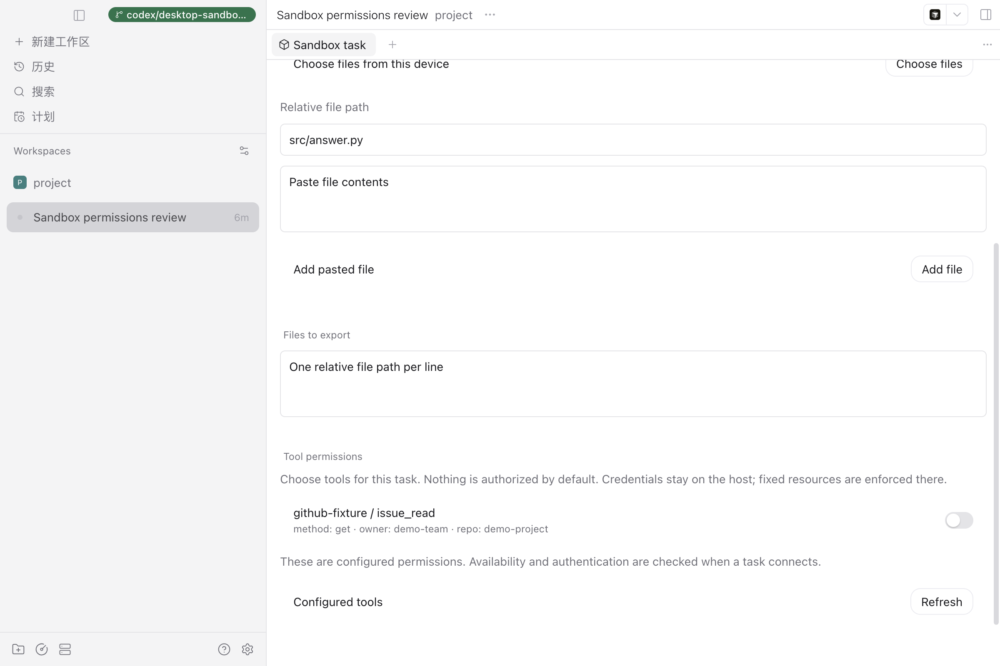
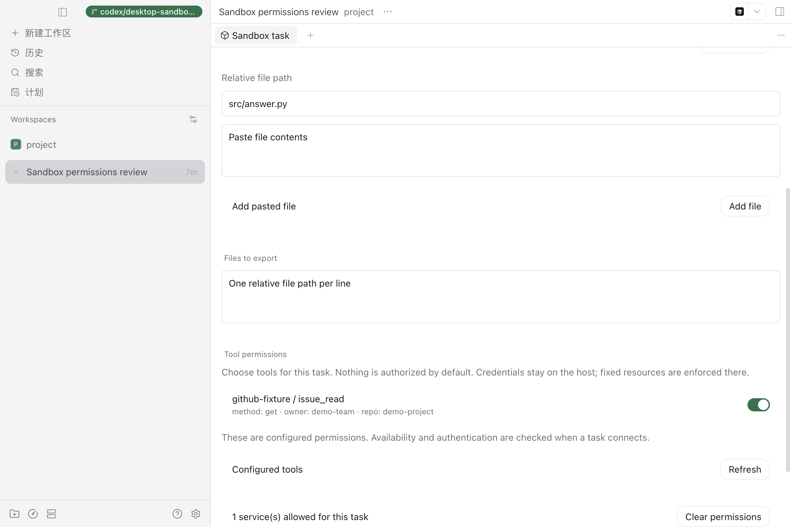

# 桌面安全沙箱验收记录

日期：2026-10-25。集成分支：`codex/secure-desktop-integration`，基线：
`babca537f433f93446c857b695033af8ffb97c8e`。本记录对应提交前的集成工作区；
它不替代 PR 最新提交上的 CI 结果。

## 环境与固定镜像

- macOS 开发机，Docker Desktop 提供 Linux Engine，宿主 Python 3.14.7，Rust 1.99.1。
- Codex CLI `0.164.0`：`sha256:b9223eebe7108e5c031d4c6d64ee225c8ce54a0b490dae1d05436d2ffec898f1`。
- Claude Code `2.1.310`：`sha256:e4ae5b8bc5b02905f887090d7125988c6e9d7a39d22ab9a72aa2a6ada63779f4`。
- 真实模型验收使用用户授权的网关与 `gpt-5.6-sol`；凭据由本机环境变量读取，不进入记录。
- 桌面交互在独立 daemon / Electron 中验证，没有重启端口 `6767` 的主 daemon。

## 已执行的行为

| 路径         | 结果与证据                                                                                                                                 | 证据边界                                         |
| ------------ | ------------------------------------------------------------------------------------------------------------------------------------------ | ------------------------------------------------ |
| Codex → MCP  | 合并后的真实 Docker、Codex CLI、HTTPS MCP 与脚本 Responses 服务用例通过；产物内容正确，`cleanup=confirmed`，独立 `docker inspect` 确认删除 | 脚本响应不证明模型推理                           |
| MCP 越权     | 容器内进程持有任务 token，直接尝试未授权工具、覆盖固定仓库、调用 `resources/read`，均被拒绝；服务端仅收到一次获准调用                      | 验证授权边界，不证明不存在内核逃逸               |
| Claude → MCP | 合并后的真实 Docker、Claude CLI、HTTPS MCP 与脚本 Messages 服务通过；工具结果、凭据隔离断言、产物和容器删除均检查                          | 未调用真实 Claude 模型                           |
| 真实模型     | MCP 子任务分支的 Codex + `gpt-5.6-sol` + HTTPS MCP 测试服务通过，耗时约 39 秒，模型自主调用工具并导出预期产物；容器已确认删除              | MCP 是受控测试服务，尚非真实 GitHub SaaS         |
| Claude 停止  | Claude 子任务分支在真实 Messages 请求开始后测试取消与期限到达，两条路径确认容器回收                                                        | 使用脚本模型服务                                 |
| 宿主凭据     | 真实 macOS Keychain 写入、读取、清理，以及 Keychain → Rust bridge 的 ready/EOF 路径通过；错误信息不包含测试密钥                            | 临时测试凭据，非用户生产凭据                     |
| 桌面设置     | 真实 Electron 中准备运行环境、保存 Keychain、reload 配置、清空密码框；更换服务地址时拒绝复用旧密钥                                         | 开发态界面，尚未验证发布安装包                   |
| 工具权限     | 真实任务面板显示固定仓库策略，初始关闭 → 手动开启 → 清空权限；成功提交后清除授权另有行为测试                                               | 权限目录使用配置 fixture，不冒充 GitHub 已认证   |
| 首次环境检测 | 全新临时配置目录通过运行器、Python、Docker 和固定 Codex 镜像检测；缺失 Python 默认 CA 时验证并采用 macOS 系统 CA                           | 本机 macOS 验证，不代表 Windows/Linux 设置已交付 |

## 复现入口

沙箱代码检查在 `circus-sandbox/` 执行：

```bash
cargo test --locked -p circus-agent-runner -p circus-stdio-bridge
cargo clippy --locked -p circus-agent-runner -p circus-stdio-bridge --all-targets -- -D warnings
```

协议、TLS 和策略测试在仓库根目录执行：

```bash
PYTHONDONTWRITEBYTECODE=1 python3 -m unittest discover \
  -s circus-sandbox/agent-runner/tests -p 'test_*.py' -v
```

真实容器用例必须显式选择本机 Engine 和已核验镜像；命令分别见
[MCP broker](mcp-broker.md#验证)与 [Claude 适配器](claude-agent.md)。
普通测试中的 Docker skip 不能计为真实容器验收。

Paseo 验证包括受影响的桌面设置、命令进程回收、可信窗口、MCP 发现、任务表单、
provider 授权和桥接测试，以及 plugin compiler/runtime 边界。使用对应单文件 Vitest
命令，不运行整个工作区测试。类型、格式和 lint 通过现有 npm scripts 检查。

## 界面证据

以下是开发态实拍，模型字段与 MCP 连接使用演示 fixture，设置截图已裁去本机标识。设置截图拍摄于增加 TLS
检测行之前；新增 TLS 分支另经真实 Python 与临时配置保存验证。






## 仍需完成的参赛验收

真实 GitHub MCP 或其他目标服务的最小权限凭据验收、真实 Claude 模型推理、`dsh`
应用身份与适配、安装包从零启动、最终演示录屏尚未完成。当前 MCP 只支持限定的 HTTPS
Streamable HTTP 工具子集；OAuth、本地 stdio MCP 与完整生态兼容仍在范围外。

完整信任边界、限制与录屏步骤见[参赛安全设计](../../docs/hackathon-security.md)。
