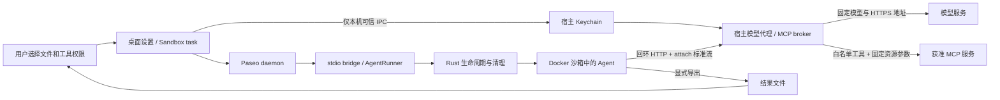

# 桌面级安全沙箱：安全边界与演示验收

Circus 的参赛主线是：**密钥留在宿主，能力按任务授权，Agent 在独立沙箱执行，结果由用户取回。**
面向最终用户的入口是桌面设置与 Sandbox task 面板。开发者可以直接调用 Rust 运行器；
这两个入口复用同一套执行与清理逻辑。

## 模块与信任边界

| 模块           | 持有的权限                                                 | 不交给沙箱的内容                          |
| -------------- | ---------------------------------------------------------- | ----------------------------------------- |
| 桌面配置       | 可信本机窗口通过 Electron IPC 保存设置与 Keychain 引用     | 真实 API key、MCP 认证 Header             |
| Paseo provider | 接收任务、输入文件与连接/工具 ID，展示进度、产物与清理状态 | 宿主环境变量、项目目录挂载、宿主 MCP 配置 |
| stdio bridge   | 读取可信宿主配置，解析有界任务消息                         | 凭证文件路径与 Keychain 查询权限          |
| 模型代理       | 调用配置中的 HTTPS 模型与协议                              | 任意上游地址、任意认证头的选择权          |
| MCP broker     | 访问显式配置的 HTTPS 服务，执行任务获准的工具              | 真实服务凭证、任意宿主程序执行权限        |
| 沙箱核心       | 创建、运行、取消、销毁及确认资源回收                       | Docker 管理 socket、宿主目录与特权能力    |

模型代理和 MCP broker 都在宿主侧；沙箱内只运行回环转发器与固定的 MCP stdio 桥。
真实模型和 MCP 凭证通过宿主私有通道读取，不写入镜像、沙箱环境变量或工作区。
沙箱内的短期通道 token 仍是一种任务能力，拥有它的进程可以消耗该任务已经获准的额度。

## 授权如何生效

MCP 授权有两个层次：本机操作者先配置服务、凭证引用、允许的工具与固定参数；
每次任务再显式勾选其中的连接和工具。默认不授予 MCP 权限。
任务消息不能提交服务 URL、凭证、宿主命令或覆盖固定资源参数。

例如，宿主配置 GitHub `issue_read`，固定 `method=get`、`owner=demo`、`repo=approved`，
只允许 Agent 提供 `issue_number`。broker 发现服务工具后只暴露获准工具，
从给 Agent 的参数 schema 中移除固定字段，并在实际请求中由宿主注入这些字段。
Agent 提交 `repo=other`、调用未授予工具或调用其他 MCP 方法时，请求被拒绝。

工具的业务语义必须由操作者确认。通用参数白名单不能证明任意 SQL、路径或工具都只读；
只读演示应使用明确的只读工具及服务端只读权限。MCP 返回内容和模型输出仍是不可信输入。
已授权服务可能收到任务数据，允许的模型通道也会收到推理上下文。

任务完成或停止后本地 broker 撤销本次授权并关闭连接。撤销不能回滚服务端已经执行的操作，
也不等于删除第三方服务保存的数据或撤销宿主的长期凭证。

## 攻击面与剩余边界

| 场景                                     | 实际控制点                                          | 验收方法                                                   |
| ---------------------------------------- | --------------------------------------------------- | ---------------------------------------------------------- |
| Agent 读取宿主密钥、SSH 目录或项目外文件 | 不挂载宿主目录，只复制显式输入；真实 key 保留宿主侧 | 容器检查、文件读取失败、凭证哨兵不出现在沙箱输出           |
| Agent 连接任意网站或私网服务             | 容器 `network=none`，宿主代理只接受固定目的地       | 容器外网连接失败；任意上游、重定向请求拒绝                 |
| Agent 越权使用 MCP                       | 默认无 grant，连接/工具白名单与固定参数             | 未授权工具及资源覆盖被拒绝，服务端未收到这些调用           |
| 配置文件或平台错误泄漏密钥               | 宿主有界读取、只返回固定错误、禁止透传认证诊断      | 无效 JSON、失败认证、超限响应和错误正文哨兵测试            |
| 恶意进程持续运行                         | 期限、取消、资源限额与生命周期拥有的销毁            | 真实取消/超时后独立检查任务容器已删除                      |
| 任务失败被误报成功                       | 成功依赖执行、产物和清理三项完成                    | `pending` / `unknown` 保留为未确认状态，不能展示为安全完成 |

当前隔离依赖 Linux Docker Engine + runc 及其宿主内核，macOS 通过 Docker Desktop 的 Linux VM 运行。
这不等于实现了独立 microVM 或证明不存在内核逃逸。已控制宿主账户、Docker daemon 或特权进程的
攻击者不在此边界内。桥接崩溃和宿主重启后的持久化回收服务仍未实现。

第一版 MCP 范围是 HTTPS Streamable HTTP 的工具发现与调用，支持受限 JSON/SSE 响应。
OAuth 登录、任意本地 stdio MCP、旧 SSE 独立订阅传输、sampling/elicitation、resources/prompts
不是这一版已经交付的能力；不能据此宣称“所有主流 MCP 已兼容”。
桌面 Keychain 设置面向 macOS，Windows/Linux 的系统凭证库与安装包分发仍需要后续实现。

## 三分钟演示脚本

1. **准备，约 30 秒。** 打开桌面设置，展示环境检测、模型连接、资源预算，以及密码框与
   “保存在本机 Keychain”的说明。展示 MCP 连接卡上的固定仓库和只读工具，不展示密钥值。
2. **正常完成，约 60 秒。** 在 Sandbox task 面板导入一份待修复代码，显式选择 MCP 读权限。
   让 Agent 读取一个受控 Issue、修复代码、运行断言并导出文件；展示工具进度和产物预览。
3. **越权被拒，约 45 秒。** 提交读取另一仓库、覆盖固定参数或访问未授权工具的请求。
   同时展示 broker 的拒绝结果与受控 MCP 服务的调用记录，避免仅凭 Agent 自述判定安全。
4. **停止与回收，约 30 秒。** 启动持续运行任务并点停止，展示确认清理状态及独立容器检查。
   再说明导出文件仍可检查，宿主源文件未被自动覆盖。
5. **收尾，约 15 秒。** 展示 Codex / Claude 的适配范围和验收层次，明确尚未支持的 MCP 类型。

录像应使用演示专用服务与最小权限凭证。画面不要出现真实密钥、个人配置、完整环境变量或私有任务数据。
将可复现的演示步骤、录屏和结果证据一起提交，不能把预录输出当现场执行。

## 验收证据的层次

当前实现的执行结果和桌面截图见[验收记录](../circus-sandbox/docs/secure-desktop-verification.md)。

每条证据应记录代码版本、执行命令、运行环境、结果和限制：

- 协议单元测试证明输入边界、授权和错误处理。
- 本地 HTTPS 测试服务证明真实 TLS、认证注入、MCP 方法与资源约束；不证明真实 SaaS 兼容。
- 真实 Docker + 固定版本 Agent CLI + 脚本模型响应证明 Agent 协议、工具执行、产物和清理；
  不证明真实模型推理。
- 真实模型 + 受控 MCP 服务证明模型自主选择并调用获准工具；MCP 服务仍须标为测试服务。
- 真实模型 + 真实 MCP 服务 + 桌面交互录像，才覆盖最终用户演示链路。

## 交付与协作记录

实现按 MCP broker、桌面配置、Claude 适配和公共接口/集成验收拆分。
这些是开发工作包；AI 子任务不计作真实人类团队成员。
提交材料中的团队分工应填写实际参赛者负责的设计、开发、验证和演示工作，并链接真实 PR。

源仓库已有导入基线 `v0`，指向 `df74dad5e9e3922c7a71ac238dd2f1306e4916d5`。
保留该基线和真实贡献历史。所有新增修改通过 PR 交付，录屏需上传 GitHub 并提供可访问链接。
按提交要求，2026-10-26 09:00（北京时间）截止后不再修改参赛仓库。
